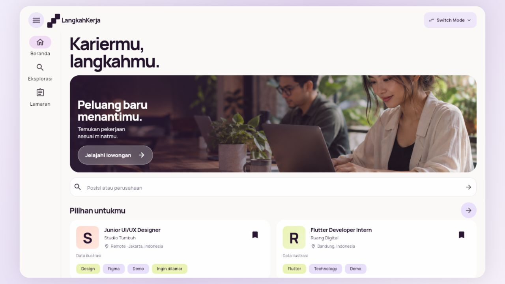

# Validasi integrasi dan responsivitas

Tanggal: **3 November 2026**. Kandidat **1.3.0+4**. Basis update tim: `8780dc0` pada `origin/main`. Pengembangan lokal 1.2 dipertahankan sebelum merge; penyelesaian konflik menggabungkan daftar fitur dan import, bukan mengganti fitur tim.

## Hasil kode dan build

| Pemeriksaan | Hasil |
|---|---|
| Dependency offline | Berhasil; tidak menambah dependency aplikasi |
| Analyzer | Tidak ada masalah |
| Seluruh tes Flutter | **45 lulus** |
| Build web | Berhasil, 66,8 detik |
| Build APK debug | Berhasil, 413,0 detik |
| Tanda tangan APK | Skema v2 valid |
| ZIP alignment | 16 KB lulus |
| ELF/RELRO 64 bit | 7 pustaka lulus |

CLI memakai Dart SDK terpasang dan `flutter_tools.snapshot` dalam `C:/Users/sastr/.codex/tools/flutter/bin/cache/`. Perintah yang dijalankan: `pub get --offline`, `analyze --no-pub`, `test --no-pub`, `build web --no-pub --no-wasm-dry-run`, dan `build apk --debug --no-pub`. Inspeksi APK memakai `scripts/check_android_apk.ps1`.

Build Android masih memberi peringatan kompatibilitas SDK XML v3/v4. Build selesai, tetapi pembaruan toolchain berikutnya tetap perlu diperiksa.

## Matriks responsif otomatis

| Viewport | Skala teks | Navigasi |
|---|---|---|
| 320×800 | 1× | Bawah |
| 390×844 | 1× | Bawah |
| 844×390 | 1× | Bawah |
| 1024×768 | 1× | Samping |
| 1440×900 | 1× | Samping |
| 320×800 | 2× | Bawah |
| 1024×768 | 2× | Samping |

Setiap kasus menelusuri Beranda, Eksplorasi, dan Lamaran serta menggulir konten tanpa overflow. Tes tambahan memeriksa query dan favorit tetap ada setelah resize dari portrait ke desktop. Font Manrope nyata dimuat pada matriks pengujian. Tidak ada klaim dukungan hinge/foldable khusus dalam perubahan ini.

## Pemeriksaan browser dan demonstrasi

Build hasil kompilasi diperiksa pada origin lokal terpisah `http://localhost:8773/`, sehingga data demonstrasi tidak memakai penyimpanan origin pratinjau sebelumnya. Alur yang dicoba: memilih Hiree, mode demo, mencari Flutter, menyimpan dua favorit, menerapkan filter remote, membaca detail, status dan catatan, perlindungan draf, agenda 4 November pukul 09.00, lamaran manual contoh, progres, perbandingan, bantuan, serta resize portrait/desktop.

Video handoff berdurasi **1 menit 47 detik** berisi 16 langkah, disusun dari 428 tangkapan layar aplikasi nyata pada titik langkah, dengan subtitle yang dibakar ke MP4 dan SRT terpisah. Ini demonstrasi per langkah tanpa suara, bukan rekaman kontinu dengan narasi pribadi atau rekaman perangkat Android. MP4 didekode penuh untuk memeriksa kerusakan, dan frame awal, tengah, portrait, serta akhir ditinjau secara visual.

[Bukti portrait](images/portrait.jpg).

## APK uji

- Lokasi: `build/app/outputs/flutter-apk/app-debug.apk`.
- App ID: `id.benelovent.langkahkerja`.
- Versi: `1.3.0`, versionCode `4`.
- minSdk 24, target/compile SDK 36.
- ABI: arm64-v8a, armeabi-v7a, x86_64.
- Ukuran: **171.834.216 byte**.
- SHA-256: `1050d786c7535a412cd4d34f4b10e5a1e7dec0036ca9c7f393734dae61e9225a`.

## Batas dan pelestarian kontribusi tim

`career_tools.dart`, `career_journey.dart`, `employer.dart`, dan `admin.dart` tidak diubah dibanding basis tim. Rekaman tidak mendemonstrasikan CV, surat lamaran, identitas/data diri, atau Perjalanan karier.

Tidak ada perubahan/deployment Supabase atau schema database. Tidak ada pengujian native pada ponsel/emulator, OTP/SMTP nyata, backend produksi, signing rilis, AAB produksi, distribusi toko, atau build iOS. Pengujian akun menggunakan fixture dan transport tiruan. Spreadsheet berisi kontribusi yang dapat ditelusuri pada kode, bukan penetapan persentase nilai anggota.
